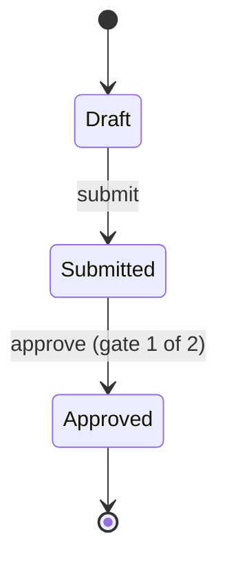

<!-- Generated by Maquettiste (process-docs/process-page). Do not edit; changes are overwritten. -->

# Order flow

An order its owner submits, and its account manager or an approver on its project approves.

| | |
| --- | --- |
| Name | `OrderFlow` |
| Domain | `Ops` |
| Use | lifecycle |
| Subject | `Order` |
| Owner held in | `Order.ownerLogin` |
| Initial state | `Draft` |

## Diagram

## States

| State | Type | Details |
| --- | --- | --- |
| `Draft` | atomic |  |
| `Submitted` | atomic |  |
| `Approved` | final |  |

## Transitions

In priority order: among the transitions of one source and one trigger, the first whose guard holds is taken.

| # | Source | Trigger | Guard | Targets | Actions | Gate |
| --- | --- | --- | --- | --- | --- | --- |
| 1 | `Draft` | event `submit` |  | `Submitted` |  |  |
| 2 | `Submitted` | event `approve` |  | `Approved` |  | `orderApproval` (1 of 2) |

## Gates

A gated transition fires on the occurrence of its event that completes the gate; each earlier occurrence records one signature
and changes no state. Leaving the source state discards the signatures.

### orderApproval

- Name: `orderApproval`
- On: transition 2, event `approve` from `Submitted` to `Approved`
- Signatures required: 1, from [Account manager](../actors/account-manager.md), [Project approver](../actors/project-approver.md)
- Repeat signer: not allowed (each signature from a different person)
- Reason: optional
- Meanings: `approved`

The audit record, one per signature attempt and per outcome of the gate:

| Field | Type | Required | Values | Description |
| --- | --- | --- | --- | --- |
| `instance` | `string` | yes |  | The process instance's identity, supplied by the host. |
| `process` | `id` | yes |  | The process. |
| `gate` | `id` | yes |  | The gate. |
| `transition` | `id` | yes |  | The gated transition. |
| `sequence` | `int64` | yes |  | The record's order within the instance. |
| `signer` | `string` | no |  | The signing person's identity, supplied by the host (never an actor id); none on a discarded record. |
| `actor` | `id` | no |  | The actor the signer signs as (one of the gate's signers); none on a discarded record. |
| `meaning` | `id` | no |  | The meaning of the signature; none on a discarded record. |
| `reason` | `text` | no |  | The signature's reason, when given. |
| `at` | `datetimeoffset` | yes |  | When the record was made, from the host's clock. |
| `outcome` | `string` | yes | `signed`, `completed`, `refused`, `discarded` | signed, completed, refused (an attempt the gate did not count) or discarded (the source state was exited). |

## Events

| Event | Raised by | Payload | Transitions | Description |
| --- | --- | --- | --- | --- |
| `submit` | [Owner](../actors/owner.md) |  | 1 |  |
| `approve` | any actor |  | 2 |  |

## Actors

| Actor | Type | Raises | Signs | Tasks |
| --- | --- | --- | --- | --- |
| [Account manager](../actors/account-manager.md) | person, the order's account manager |  | `orderApproval` |  |
| [Owner](../actors/owner.md) | person, the order's owner | `submit` |  |  |
| [Project approver](../actors/project-approver.md) | role, members of Approver within the order's project |  | `orderApproval` |  |

## Scenarios

- [Project approval](order-flow/project-approval.md): 3 steps, ends final
