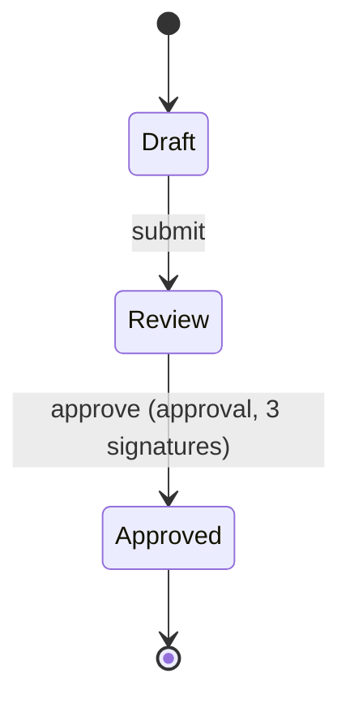

<!-- Generated by Maquettiste (process-docs/process-page). Do not edit; changes are overwritten. -->

# DocumentLifecycle

| | |
| --- | --- |
| Name | `DocumentLifecycle` |
| Domain | `Docs` |
| Use | lifecycle |
| Subject | `Document` |
| Initial state | `Draft` |

## Diagram

## States

| State | Type | Details |
| --- | --- | --- |
| `Draft` | atomic |  |
| `Review` | atomic |  |
| `Approved` | final |  |

## Transitions

In priority order: among the transitions of one source and one trigger, the first whose guard holds is taken.

| # | Source | Trigger | Guard | Targets | Actions | Gate | Verb |
| --- | --- | --- | --- | --- | --- | --- | --- |
| 1 | `Draft` | event `submit` |  | `Review` |  |  | `promote` |
| 2 | `Review` | event `approve` |  | `Approved` |  | `Release` (approval, 3 signatures) |  |

## Gates

A gated transition fires on the occurrence of its event that completes the gate; each earlier occurrence records one signature
and changes no state. Leaving the source state discards the signatures.

### Release approval

- Name: `Release`
- On: transition 2, event `approve` from `Review` to `Approved`
- One person may give several signatures: no (each person gives at most one response that counts)
- Reason: optional
- Meanings: `approved`

#### Approval

A signer answers the approval with a response on the gated event. Sign counts one signature on a named signature, and the occurrence
that completes the last needed signature makes the move. Reject is a veto: it clears every signature of the approval, moves nothing and
starts the approval again. Ignore (abstain) finishes that person on the signature and leaves the count. Withdraw takes back the person's
latest signature. A signature is needed unless its condition is false when the approval starts: when the object enters the source
state, after a rejection, and after the gated move completes without leaving it. Leaving the source state discards every response.

Stages run in rounds, lowest first. A signature that completes a round before the last starts the next round and moves nothing;
the signature that completes the last round makes the move.
When a round starts, its stages' conditions are judged, then the conditions of the signatures in the stages not skipped. A stage
whose condition is false is skipped.

A signer of a signature that may be delegated can hand their part to a person who meets one of its delegate actors. That person then
answers on the signer's behalf, and the answer counts as the signer's. A delegation can't be passed on; a rejection or leaving the source
state ends it.

A reminder goes to the people who may still answer a signature, its Remind after time after its round started.
An escalation goes to its Escalate to actors, its Escalate after time after its round started, and gives them
no right to sign.
Each is sent once per round start, by the running system, and never moves the object.

A signature signed again with a password asks the running system to check the person's identity again for every response on it.

Stage `Review` (Review round):

- Round: 1

| Signature | Signers | Required | Required actors | Repeat signer | Needed when | Not by | May be delegated to | Remind after | Escalate after | Escalate to | Signed again with a password | Why |
| --- | --- | --- | --- | --- | --- | --- | --- | --- | --- | --- | --- | --- |
| `Engineering` | [Engineer](../actors/engineer.md) | 1 |  | no | always |  | [Controller](../actors/controller.md) | `P2D` | `P5D` | [QualityLead](../actors/quality-lead.md) | no | An engineer, or a controller the engineer hands it to. |
| `Quality` (Quality check) | [QualityLead](../actors/quality-lead.md) | 1 |  | no | always |  |  |  |  |  | yes |  |

Stage `Finance` (Finance round): Only for costly documents.

- Round: 2
- Skip unless: `subject.cost > 10000`

| Signature | Signers | Required | Required actors | Repeat signer | Needed when | Not by | May be delegated to | Remind after | Escalate after | Escalate to | Signed again with a password | Why |
| --- | --- | --- | --- | --- | --- | --- | --- | --- | --- | --- | --- | --- |
| `Controller` | [Controller](../actors/controller.md) | 1 |  | no | always |  |  | `P1D` |  |  | no |  |

The audit record, one per response and per outcome of the approval:

| Field | Type | Required | Values | Description |
| --- | --- | --- | --- | --- |
| `instance` | `string` | yes |  | The process instance's identity, supplied by the host. |
| `process` | `id` | yes |  | The process. |
| `gate` | `id` | yes |  | The gate. |
| `transition` | `id` | yes |  | The gated transition. |
| `sequence` | `int64` | yes |  | The record's order within the instance. |
| `signer` | `string` | no |  | The signing person's identity, supplied by the host (never an actor id); none on a discarded record. |
| `actor` | `id` | no |  | The actor the signer answers as (one of the named signature's signers); none on a discarded record. |
| `meaning` | `id` | no |  | The meaning of the signature; none on a discarded record. |
| `reason` | `text` | no |  | The signature's reason, when given. |
| `at` | `datetimeoffset` | yes |  | When the record was made, from the host's clock. |
| `outcome` | `string` | yes | `signed`, `completed`, `refused`, `discarded`, `rejected`, `ignored`, `withdrawn`, `delegated` | signed, completed, refused (an attempt the approval did not count), discarded (the source state was exited), rejected (a veto cleared the approval), ignored (a person abstained on a signature), withdrawn (a person took back a signature) or delegated (a person handed their part of a signature to someone else). |
| `signature` | `id` | no |  | The named signature the record is about; none on a record about the whole approval. |
| `stage` | `id` | no |  | The stage of the signature; none when the record names no signature. |
| `onBehalfOf` | `string` | no |  | For an answer on behalf of someone who delegated the signature, the delegator's identity; none otherwise. |
| `delegateTo` | `string` | no |  | For a delegation, the identity it went to; none otherwise. |

## Events

| Event | Verb | Raised by | Payload | Transitions | Description |
| --- | --- | --- | --- | --- | --- |
| `submit` | `promote` | [Engineer](../actors/engineer.md) |  | 1 |  |
| `approve` |  | any actor |  | 2 |  |

## Actors

| Actor | Type | Raises | Signs | Tasks |
| --- | --- | --- | --- | --- |
| [Controller](../actors/controller.md) | role |  | `Release.Controller` |  |
| [Engineer](../actors/engineer.md) | role | `submit` | `Release.Engineering` |  |
| [QualityLead](../actors/quality-lead.md) | role |  | `Release.Quality` |  |

## Scenarios

- [handedOver](document-lifecycle/handed-over.md): 4 steps, ends active
