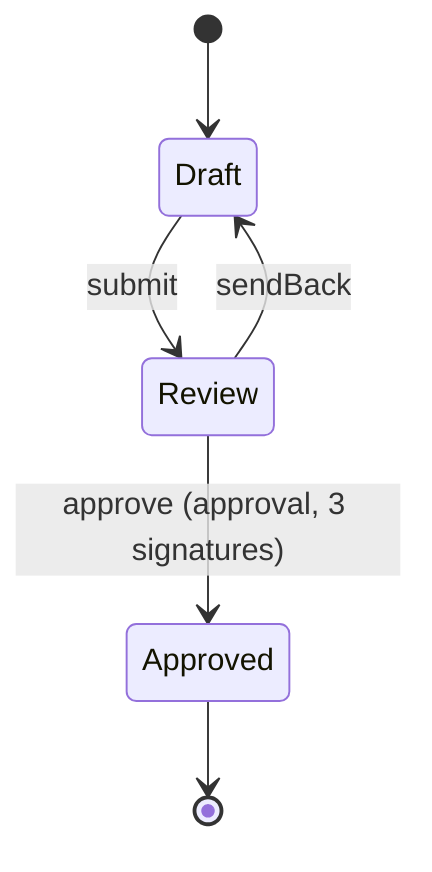

<!-- Generated by Maquettiste (process-docs/process-page). Do not edit; changes are overwritten. -->

# DocumentLifecycle

| | |
| --- | --- |
| Name | `DocumentLifecycle` |
| Domain | `Docs` |
| Use | lifecycle |
| Subject | `Document` |
| Initial state | `Draft` |

## Diagram

## States

| State | Type | Details |
| --- | --- | --- |
| `Draft` | atomic |  |
| `Review` | atomic |  |
| `Approved` | final |  |

## Transitions

In priority order: among the transitions of one source and one trigger, the first whose guard holds is taken.

| # | Source | Trigger | Guard | Targets | Actions | Gate | Verb |
| --- | --- | --- | --- | --- | --- | --- | --- |
| 1 | `Draft` | event `submit` |  | `Review` |  |  | `promote` |
| 2 | `Review` | event `approve` |  | `Approved` |  | `Release` (approval, 3 signatures) |  |
| 3 | `Review` | event `sendBack` |  | `Draft` |  |  | `reject` |

## Gates

A gated transition fires on the occurrence of its event that completes the gate; each earlier occurrence records one signature
and changes no state. Leaving the source state discards the signatures.

### Release approval

- Name: `Release`
- On: transition 2, event `approve` from `Review` to `Approved`
- One person may give several signatures: no (each person gives at most one response that counts)
- Reason: optional
- Meanings: `approved`

#### Approval

A signer answers the approval with a response on the gated event. Sign counts one signature on a named signature, and the occurrence
that completes the last needed signature makes the move. Reject is a veto: it clears every signature of the approval, moves nothing and
starts the approval again. Ignore (abstain) finishes that person on the signature and leaves the count. Withdraw takes back the person's
latest signature. A signature is needed unless its condition is false when the approval starts: when the object enters the source
state, after a rejection, and after the gated move completes without leaving it. Leaving the source state discards every response.

Stage `Review` (Review round):

| Signature | Signers | Required | Required actors | Repeat signer | Needed when | Not by | Why |
| --- | --- | --- | --- | --- | --- | --- | --- |
| `Engineering` | [Engineer](../actors/engineer.md) | 2 |  | no | always | verb `promote`, transition 1 | Two engineers who did not submit it. |
| `Quality` (Quality check) | [QualityLead](../actors/quality-lead.md) | 1 | [QualityLead](../actors/quality-lead.md) | no | always |  |  |
| `Finance` | [Controller](../actors/controller.md) | 1 |  | allowed | `subject.cost > 10000` |  | Needed for costs above 10,000. |

The audit record, one per response and per outcome of the approval:

| Field | Type | Required | Values | Description |
| --- | --- | --- | --- | --- |
| `instance` | `string` | yes |  | The process instance's identity, supplied by the host. |
| `process` | `id` | yes |  | The process. |
| `gate` | `id` | yes |  | The gate. |
| `transition` | `id` | yes |  | The gated transition. |
| `sequence` | `int64` | yes |  | The record's order within the instance. |
| `signer` | `string` | no |  | The signing person's identity, supplied by the host (never an actor id); none on a discarded record. |
| `actor` | `id` | no |  | The actor the signer answers as (one of the named signature's signers); none on a discarded record. |
| `meaning` | `id` | no |  | The meaning of the signature; none on a discarded record. |
| `reason` | `text` | no |  | The signature's reason, when given. |
| `at` | `datetimeoffset` | yes |  | When the record was made, from the host's clock. |
| `outcome` | `string` | yes | `signed`, `completed`, `refused`, `discarded`, `rejected`, `ignored`, `withdrawn` | signed, completed, refused (an attempt the approval did not count), discarded (the source state was exited), rejected (a veto cleared the approval), ignored (a person abstained on a signature) or withdrawn (a person took back a signature). |
| `signature` | `id` | no |  | The named signature the record is about; none on a record about the whole approval. |
| `stage` | `id` | no |  | The stage of the signature; none when the record names no signature. |

## Events

| Event | Verb | Raised by | Payload | Transitions | Description |
| --- | --- | --- | --- | --- | --- |
| `submit` | `promote` | any actor |  | 1 |  |
| `approve` |  | any actor |  | 2 |  |
| `sendBack` | `reject` | any actor |  | 3 |  |

## Actors

| Actor | Type | Raises | Signs | Tasks |
| --- | --- | --- | --- | --- |
| [Controller](../actors/controller.md) | role |  | `Release.Finance` |  |
| [Engineer](../actors/engineer.md) | role |  | `Release.Engineering` |  |
| [QualityLead](../actors/quality-lead.md) | role |  | `Release.Quality` (required) |  |

## Scenarios

- [submitterExcluded](document-lifecycle/submitter-excluded.md): 4 steps, ends active
