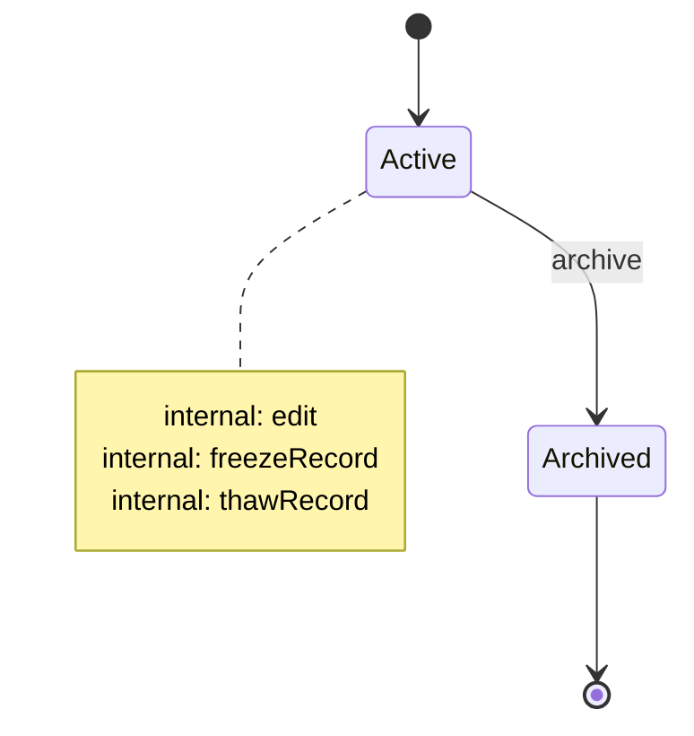

<!-- Generated by Maquettiste (process-docs/process-page). Do not edit; changes are overwritten. -->

# EmployeeRecord

| | |
| --- | --- |
| Name | `EmployeeRecord` |
| Domain | `Staff` |
| Use | lifecycle |
| Subject | `Employee` |
| Initial state | `Active` |

## Diagram

## States

| State | Type | Details |
| --- | --- | --- |
| `Active` | atomic |  |
| `Archived` | final |  |

## Transitions

In priority order: among the transitions of one source and one trigger, the first whose guard holds is taken.

| # | Source | Trigger | Guard | Targets | Actions | Gate | Verb |
| --- | --- | --- | --- | --- | --- | --- | --- |
| 1 | `Active` | event `edit` |  | none (stays in the source) |  |  | `modify` |
| 2 | `Active` | event `freezeRecord` |  | none (stays in the source) |  |  | `freeze` |
| 3 | `Active` | event `thawRecord` |  | none (stays in the source) |  |  | `thaw` |
| 4 | `Active` | event `archive` |  | `Archived` |  |  | `promote` |

## Events

| Event | Verb | Raised by | Payload | Transitions | Description |
| --- | --- | --- | --- | --- | --- |
| `edit` | `modify` | any actor |  | 1 |  |
| `freezeRecord` | `freeze` | any actor |  | 2 |  |
| `thawRecord` | `thaw` | any actor |  | 3 |  |
| `archive` | `promote` | any actor |  | 4 |  |

## Rights

Anything not stated here is allowed. Each lifecycle that governs an
object answers on its own, and any no wins.

| Right | Allows or denies | Who | Except | Does | Attributes | In states | While frozen | When | Why |
| --- | --- | --- | --- | --- | --- | --- | --- | --- | --- |
| `SalaryHrOnly` | denies | everyone | [HrStaff](../actors/hr-staff.md) | `read`, `modify` | `salary` | all states |  |  | Only HR staff read or change a salary. |
| `OwnerKeptWhileFrozen` ([named](../rights.md)) | denies | everyone |  | `change-owner` |  | all states | yes |  | A frozen record keeps its owner. |

### Who can do what

One table per state: each actor the rights, events, tasks and gates name, then everyone else, and each verb.

#### `Active`

| Who | Does | Answer | Decided by |
| --- | --- | --- | --- |
| [HrStaff](../actors/hr-staff.md) | `change-owner` | allowed (default) | the default of EmployeeRecord |
| [HrStaff](../actors/hr-staff.md) | `freeze` | allowed (default) | the default of EmployeeRecord |
| [HrStaff](../actors/hr-staff.md) | `modify` | allowed (default) | the default of EmployeeRecord |
| [HrStaff](../actors/hr-staff.md) | `promote` | allowed (default) | the default of EmployeeRecord |
| [HrStaff](../actors/hr-staff.md) | `read` | allowed (default) | the default of EmployeeRecord |
| [HrStaff](../actors/hr-staff.md) | `thaw` | allowed (default) | the default of EmployeeRecord |
| everyone else | `change-owner` | allowed (default) | the default of EmployeeRecord |
| everyone else | `freeze` | allowed (default) | the default of EmployeeRecord |
| everyone else | `modify` | depends | `SalaryHrOnly` |
| everyone else | `promote` | allowed (default) | the default of EmployeeRecord |
| everyone else | `read` | depends | `SalaryHrOnly` |
| everyone else | `thaw` | allowed (default) | the default of EmployeeRecord |

#### `Archived`

| Who | Does | Answer | Decided by |
| --- | --- | --- | --- |
| [HrStaff](../actors/hr-staff.md) | `change-owner` | allowed (default) | the default of EmployeeRecord |
| [HrStaff](../actors/hr-staff.md) | `freeze` | allowed (default) | the default of EmployeeRecord |
| [HrStaff](../actors/hr-staff.md) | `modify` | allowed (default) | the default of EmployeeRecord |
| [HrStaff](../actors/hr-staff.md) | `promote` | allowed (default) | the default of EmployeeRecord |
| [HrStaff](../actors/hr-staff.md) | `read` | allowed (default) | the default of EmployeeRecord |
| [HrStaff](../actors/hr-staff.md) | `thaw` | allowed (default) | the default of EmployeeRecord |
| everyone else | `change-owner` | allowed (default) | the default of EmployeeRecord |
| everyone else | `freeze` | allowed (default) | the default of EmployeeRecord |
| everyone else | `modify` | depends | `SalaryHrOnly` |
| everyone else | `promote` | allowed (default) | the default of EmployeeRecord |
| everyone else | `read` | depends | `SalaryHrOnly` |
| everyone else | `thaw` | allowed (default) | the default of EmployeeRecord |

## Scenarios

- [Freezing](employee-record/freezing.md): 9 steps, ends final
- [FrozenStart](employee-record/frozen-start.md): 2 steps, ends active
