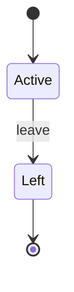

<!-- Generated by Maquettiste (process-docs/process-page). Do not edit; changes are overwritten. -->

# Employment

| | |
| --- | --- |
| Name | `Employment` |
| Domain | `Requests` |
| Use | lifecycle |
| Subject | `Employee` |
| Initial state | `Active` |

## Diagram

## States

| State | Type | Details |
| --- | --- | --- |
| `Active` | atomic |  |
| `Left` | final |  |

## Transitions

In priority order: among the transitions of one source and one trigger, the first whose guard holds is taken.

| # | Source | Trigger | Guard | Targets | Actions | Gate |
| --- | --- | --- | --- | --- | --- | --- |
| 1 | `Active` | event `leave` |  | `Left` |  |  |

## Events

| Event | Raised by | Payload | Transitions | Description |
| --- | --- | --- | --- | --- |
| `leave` | any actor |  | 1 |  |
