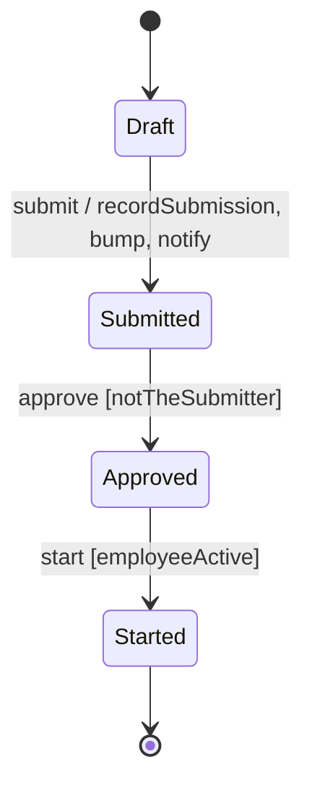

<!-- Generated by Maquettiste (process-docs/process-page). Do not edit; changes are overwritten. -->

# RequestLifecycle

| | |
| --- | --- |
| Name | `RequestLifecycle` |
| Domain | `Requests` |
| Use | lifecycle |
| Subject | `Request` |
| Initial state | `Draft` |

## Diagram

## States

| State | Type | Details |
| --- | --- | --- |
| `Draft` | atomic |  |
| `Submitted` | atomic |  |
| `Approved` | atomic |  |
| `Started` | final |  |

## Transitions

In priority order: among the transitions of one source and one trigger, the first whose guard holds is taken.

| # | Source | Trigger | Guard | Targets | Actions | Gate |
| --- | --- | --- | --- | --- | --- | --- |
| 1 | `Draft` | event `submit` |  | `Submitted` | `recordSubmission`, `bump`, `notify` |  |
| 2 | `Submitted` | event `approve` | `notTheSubmitter` | `Approved` |  |  |
| 3 | `Approved` | event `start` | `employeeActive` | `Started` |  |  |

## Events

| Event | Raised by | Payload | Transitions | Description |
| --- | --- | --- | --- | --- |
| `submit` | any actor |  | 1 |  |
| `approve` | any actor |  | 2 |  |
| `start` | any actor |  | 3 |  |

## Context

The data a running instance carries.

| Attribute | Type | Required | Default | Description |
| --- | --- | --- | --- | --- |
| `count` | `int32` | no | `0` |  |

## Guards

| Guard | Expression | Used by transitions | Description |
| --- | --- | --- | --- |
| `notTheSubmitter` | `subject.submittedBy <> actor()` | 2 |  |
| `employeeActive` | `in_state(subject.employee, Employment.Active)` | 3 |  |

## Actions

| Action | Expression | Sets | Raises | Used by | Description |
| --- | --- | --- | --- | --- | --- |
| `recordSubmission` | `submittedBy ← actor()`, `submittedOn ← now()` | `submittedBy ← actor()`, `submittedOn ← now()` |  | transition 1 |  |
| `bump` | `({ count: context.count + 1 })` | `note ← 'bumped'` |  | transition 1 |  |
| `notify` | none: a named stub the host implements |  |  | transition 1 |  |

## Scenarios

- [Separate approver](request-lifecycle/separate-approver.md): 4 steps, ends final
