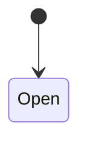

<!-- Generated by Maquettiste (process-docs/process-page). Do not edit; changes are overwritten. -->

# Approval

| | |
| --- | --- |
| Name | `Approval` |
| Domain | `Engineering` |
| Use | lifecycle |
| Subject | `Specification` |
| Initial state | `Open` |

## Diagram

## States

| State | Type | Details |
| --- | --- | --- |
| `Open` | atomic |  |
