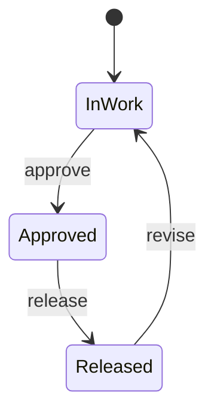

<!-- Generated by Maquettiste (process-docs/process-page). Do not edit; changes are overwritten. -->

# DrawingLifecycle

| | |
| --- | --- |
| Name | `DrawingLifecycle` |
| Domain | `Engineering` |
| Use | lifecycle |
| Subject | `Drawing` |
| Initial state | `InWork` |

## Diagram

## States

| State | Type | Details |
| --- | --- | --- |
| `InWork` | atomic |  |
| `Approved` | atomic |  |
| `Released` | atomic |  |

## Transitions

In priority order: among the transitions of one source and one trigger, the first whose guard holds is taken.

| # | Source | Trigger | Guard | Targets | Actions | Gate | Verb |
| --- | --- | --- | --- | --- | --- | --- | --- |
| 1 | `InWork` | event `approve` |  | `Approved` |  |  |  |
| 2 | `Approved` | event `release` |  | `Released` |  |  | `promote` |
| 3 | `Released` | event `revise` |  | `InWork` |  |  | `revise` |

## Events

| Event | Verb | Raised by | Payload | Transitions | Description |
| --- | --- | --- | --- | --- | --- |
| `approve` |  | any actor |  | 1 |  |
| `release` | `promote` | any actor |  | 2 |  |
| `revise` | `revise` | any actor |  | 3 |  |

## Scenarios

- [ReleaseAndRevise](drawing-lifecycle/release-and-revise.md): 3 steps, ends active
