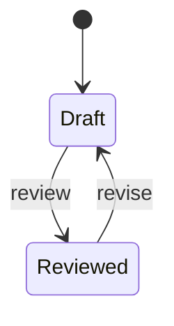

<!-- Generated by Maquettiste (process-docs/process-page). Do not edit; changes are overwritten. -->

# ReviewLifecycle

| | |
| --- | --- |
| Name | `ReviewLifecycle` |
| Domain | `Engineering` |
| Use | lifecycle |
| Subject | `Specification` |
| Initial state | `Draft` |

## Diagram

## States

| State | Type | Details |
| --- | --- | --- |
| `Draft` | atomic |  |
| `Reviewed` | atomic |  |

## Transitions

In priority order: among the transitions of one source and one trigger, the first whose guard holds is taken.

| # | Source | Trigger | Guard | Targets | Actions | Gate | Verb |
| --- | --- | --- | --- | --- | --- | --- | --- |
| 1 | `Draft` | event `review` |  | `Reviewed` |  |  | `promote` |
| 2 | `Reviewed` | event `revise` |  | `Draft` |  |  | `revise` |

## Events

| Event | Verb | Raised by | Payload | Transitions | Description |
| --- | --- | --- | --- | --- | --- |
| `review` | `promote` | any actor |  | 1 |  |
| `revise` | `revise` | any actor |  | 2 |  |
