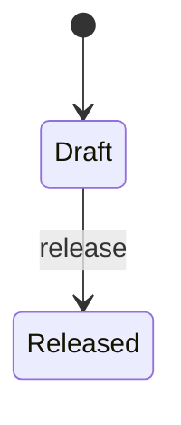

<!-- Generated by Maquettiste (process-docs/process-page). Do not edit; changes are overwritten. -->

# DocumentLifecycle

| | |
| --- | --- |
| Name | `DocumentLifecycle` |
| Domain | `Docs` |
| Use | lifecycle |
| Subject | `Document` |
| Initial state | `Draft` |

## Diagram

## States

| State | Type | Details |
| --- | --- | --- |
| `Draft` | atomic |  |
| `Released` | atomic |  |

## Transitions

In priority order: among the transitions of one source and one trigger, the first whose guard holds is taken.

| # | Source | Trigger | Guard | Targets | Actions | Gate | Verb |
| --- | --- | --- | --- | --- | --- | --- | --- |
| 1 | `Draft` | event `release` |  | `Released` |  |  | `promote` |

## Events

| Event | Verb | Raised by | Payload | Transitions | Description |
| --- | --- | --- | --- | --- | --- |
| `release` | `promote` | [Author](../actors/author.md) |  | 1 |  |

## Rights

Anything not stated here is denied. Each lifecycle that governs an
object answers on its own, and any no wins.

| Right | Allows or denies | Who | Except | Does | In states | When | Why |
| --- | --- | --- | --- | --- | --- | --- | --- |
| `EveryoneReads` | allows | everyone |  | `read` | all states |  |  |
| `AuthorsEditDrafts` | allows | [Author](../actors/author.md) |  | `modify` | `Draft` |  |  |
| `ReleasedIsReadOnly` | denies | everyone |  | `modify`, `delete` | `Released` |  | A released document changes only by revising it. |
| `SecretOnlyOwner` ([named](../rights.md)) | denies | everyone | [DocumentOwner](../actors/document-owner.md) | `modify`, `delete`, `change-owner` | all states | `subject.classification = 'secret'` | Only its owner may change a secret item. |

### Who can do what

One table per state: each actor the rights, events, tasks and gates name, then everyone else, and each verb.

#### `Draft`

| Who | Does | Answer | Decided by |
| --- | --- | --- | --- |
| [Author](../actors/author.md) | `change-owner` | denied (default) | the default of DocumentLifecycle |
| [Author](../actors/author.md) | `delete` | denied (default) | the default of DocumentLifecycle |
| [Author](../actors/author.md) | `modify` | depends | `SecretOnlyOwner` |
| [Author](../actors/author.md) | `promote` | allowed | `release` |
| [Author](../actors/author.md) | `read` | allowed | `EveryoneReads` |
| [DocumentOwner](../actors/document-owner.md) | `change-owner` | denied (default) | the default of DocumentLifecycle |
| [DocumentOwner](../actors/document-owner.md) | `delete` | denied (default) | the default of DocumentLifecycle |
| [DocumentOwner](../actors/document-owner.md) | `modify` | denied (default) | the default of DocumentLifecycle |
| [DocumentOwner](../actors/document-owner.md) | `promote` | denied | `release` |
| [DocumentOwner](../actors/document-owner.md) | `read` | allowed | `EveryoneReads` |
| everyone else | `change-owner` | denied (default) | the default of DocumentLifecycle |
| everyone else | `delete` | denied (default) | the default of DocumentLifecycle |
| everyone else | `modify` | denied (default) | the default of DocumentLifecycle |
| everyone else | `promote` | denied | `release` |
| everyone else | `read` | allowed | `EveryoneReads` |

#### `Released`

| Who | Does | Answer | Decided by |
| --- | --- | --- | --- |
| [Author](../actors/author.md) | `change-owner` | denied (default) | the default of DocumentLifecycle |
| [Author](../actors/author.md) | `delete` | denied | `ReleasedIsReadOnly` |
| [Author](../actors/author.md) | `modify` | denied | `ReleasedIsReadOnly` |
| [Author](../actors/author.md) | `promote` | denied (default) | the default of DocumentLifecycle |
| [Author](../actors/author.md) | `read` | allowed | `EveryoneReads` |
| [DocumentOwner](../actors/document-owner.md) | `change-owner` | denied (default) | the default of DocumentLifecycle |
| [DocumentOwner](../actors/document-owner.md) | `delete` | denied | `ReleasedIsReadOnly` |
| [DocumentOwner](../actors/document-owner.md) | `modify` | denied | `ReleasedIsReadOnly` |
| [DocumentOwner](../actors/document-owner.md) | `promote` | denied (default) | the default of DocumentLifecycle |
| [DocumentOwner](../actors/document-owner.md) | `read` | allowed | `EveryoneReads` |
| everyone else | `change-owner` | denied (default) | the default of DocumentLifecycle |
| everyone else | `delete` | denied | `ReleasedIsReadOnly` |
| everyone else | `modify` | denied | `ReleasedIsReadOnly` |
| everyone else | `promote` | denied (default) | the default of DocumentLifecycle |
| everyone else | `read` | allowed | `EveryoneReads` |

## Actors

| Actor | Type | Raises | Signs | Tasks |
| --- | --- | --- | --- | --- |
| [Author](../actors/author.md) | role | `release` |  |  |

## Scenarios

- [Secret edits](document-lifecycle/secret-edits.md): 2 steps, ends active
