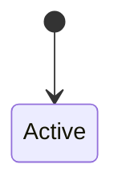

<!-- Generated by Maquettiste (process-docs/process-page). Do not edit; changes are overwritten. -->

# HR

| | |
| --- | --- |
| Name | `Hr` |
| Domain | `Docs` |
| Use | lifecycle |
| Subject | `Employee` |
| Initial state | `Active` |

## Diagram

## States

| State | Type | Details |
| --- | --- | --- |
| `Active` | atomic |  |

## Rights

Anything not stated here is denied. Each lifecycle that governs an
object answers on its own, and any no wins.

| Right | Allows or denies | Who | Except | Does | In states | When | Why |
| --- | --- | --- | --- | --- | --- | --- | --- |
| `HrStaffEdits` | allows | [HrStaff](../actors/hr-staff.md) |  | `modify` | all states |  |  |

### Who can do what

One table per state: each actor the rights, events, tasks and gates name, then everyone else, and each verb.

#### `Active`

| Who | Does | Answer | Decided by |
| --- | --- | --- | --- |
| [HrStaff](../actors/hr-staff.md) | `modify` | allowed | `HrStaffEdits` |
| everyone else | `modify` | denied (default) | the default of HR |
