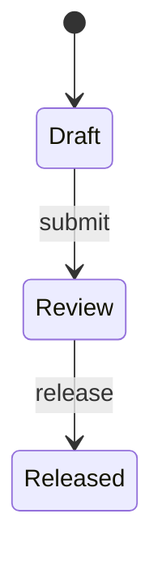

<!-- Generated by Maquettiste (process-docs/process-page). Do not edit; changes are overwritten. -->

# DocumentLifecycle

| | |
| --- | --- |
| Name | `DocumentLifecycle` |
| Domain | `Docs` |
| Use | lifecycle |
| Subject | `Document` |
| Initial state | `Draft` |

## Diagram

## States

| State | Type | Details |
| --- | --- | --- |
| `Draft` | atomic |  |
| `Review` | atomic |  |
| `Released` | atomic |  |

## Transitions

In priority order: among the transitions of one source and one trigger, the first whose guard holds is taken.

| # | Source | Trigger | Guard | Targets | Actions | Gate | Verb |
| --- | --- | --- | --- | --- | --- | --- | --- |
| 1 | `Draft` | event `submit` |  | `Review` |  |  | `promote` |
| 2 | `Review` | event `release` |  | `Released` |  |  | `promote` |

## Events

| Event | Verb | Raised by | Payload | Transitions | Description |
| --- | --- | --- | --- | --- | --- |
| `submit` | `promote` | any actor |  | 1 |  |
| `release` | `promote` | any actor |  | 2 |  |

## Trigger points

What runs when a verb happens: checks refuse or warn, actions run before the checks, with the change or after commit, and a replace
takes the place of a verb's built-in effect. At each moment they run in the order listed.

| Trigger point | Type | Does | Where | When | What it does | Severity | Outside | Why |
| --- | --- | --- | --- | --- | --- | --- | --- | --- |
| `AssignNumber` | action, before the checks | `create` | everywhere | always | the team's code |  |  | Gives the document its number, such as DOC-000123. |
| `TitleBeforeReview` | check | `promote` | into `Review` | always | `coalesce(subject.title, '') <> ''` | error |  | A document needs a title before it goes to review. |
| `LargePriceDrop` | check | `modify` | attributes `price` | always | `coalesce(old.price, 0) = 0 or subject.price >= old.price * 0.9` | warning |  | The price dropped by more than a tenth. |
| `StampRelease` | action, with the change | `promote` | into `Released` | always | sets `releasedOn ← now()` |  |  |  |
| `PublishToPortal` | action, after commit | `promote` | into `Released` | always | the team's code |  | yes | Sends the released document to the supplier portal. |
| `ApprovedForDeletion` | check | `delete` | everywhere | always | the team's code | error | yes | The records office approves the deletion. |
| `Archive` | replace | `delete` | in `Released` | always | sets `archivedOn ← now()` |  |  | Released documents are archived, never removed. |

### What happens when someone promotes a `Document`

1. Rights, the move's guard and, on a gated move, who may sign are checked.
1. `TitleBeforeReview` (check): passes when `coalesce(subject.title, '') <> ''`; otherwise it refuses: A document needs a title before it goes to review. Only into `Review`.
1. The move: its exit, transition and entry actions.
1. With the change, `StampRelease` (action, with the change): sets `releasedOn ← now()`. Only into `Released`.
1. After commit, `PublishToPortal` (action, after commit): the team's code: Sends the released document to the supplier portal. Only into `Released`. It reaches outside systems. It may run late, or more than once.

### What happens when someone creates a `Document`

1. Rights are checked.
1. Before the checks, `AssignNumber` (action, before the checks): the team's code: Gives the document its number, such as DOC-000123.
1. The verb's built-in effect.

Other lifecycles that govern the object run their own trigger points at each moment too, after these.

### What happens when someone modifies a `Document`

1. Freezing and rights are checked.
1. `LargePriceDrop` (warning check): passes when `coalesce(old.price, 0) = 0 or subject.price >= old.price * 0.9`; otherwise it warns: The price dropped by more than a tenth. Only attributes `price`.
1. The verb's built-in effect.

Other lifecycles that govern the object run their own trigger points at each moment too, after these.

### What happens when someone deletes a `Document`

1. Freezing and rights are checked.
1. `ApprovedForDeletion` (check): the team's code: The records office approves the deletion. It reaches outside systems.
1. In place of the built-in effect, `Archive` (replace): sets `archivedOn ← now()`. Only in `Released`.
1. Where no replace applies, the verb's built-in effect.

Other lifecycles that govern the object run their own trigger points at each moment too, after these.

## Scenarios

- [untitledSubmit](document-lifecycle/untitled-submit.md): 3 steps, ends active
