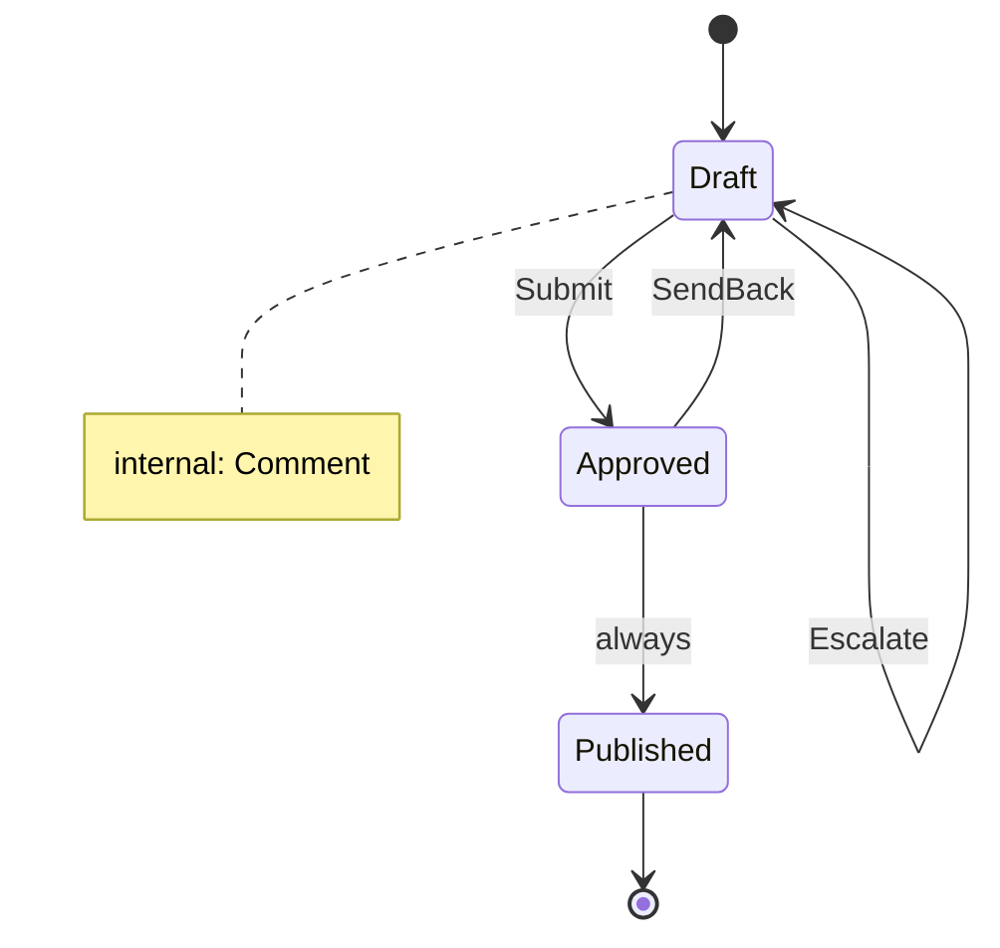

<!-- Generated by Maquettiste (process-docs/process-page). Do not edit; changes are overwritten. -->

# DocumentLifecycle

| | |
| --- | --- |
| Name | `DocumentLifecycle` |
| Domain | `Docs` |
| Use | lifecycle |
| Subject | `Document` |
| Initial state | `Draft` |

## Diagram

## States

| State | Type | Details |
| --- | --- | --- |
| `Draft` | atomic |  |
| `Approved` | atomic |  |
| `Published` | final |  |

## Transitions

In priority order: among the transitions of one source and one trigger, the first whose guard holds is taken.

| # | Source | Trigger | Guard | Targets | Actions | Gate | Verb |
| --- | --- | --- | --- | --- | --- | --- | --- |
| 1 | `Draft` | event `Submit` |  | `Approved` |  |  | `promote` |
| 2 | `Approved` | event `SendBack` |  | `Draft` |  |  | `demote` |
| 3 | `Approved` | always |  | `Published` |  |  | `promote` |
| 4 | `Draft` | event `Escalate` |  | `Draft` |  |  | `escalate` |
| 5 | `Draft` | event `Comment` |  | none (stays in the source) |  |  |  |

## Events

| Event | Verb | Raised by | Payload | Transitions | Description |
| --- | --- | --- | --- | --- | --- |
| `Submit` | `promote` | any actor |  | 1 |  |
| `SendBack` | `demote` | any actor |  | 2 |  |
| `Escalate` | `escalate` | any actor |  | 4 |  |
| `Comment` |  | any actor |  | 5 |  |
