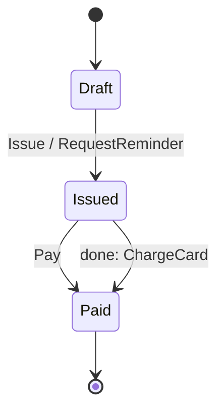

<!-- Generated by Maquettiste (process-docs/process-page). Do not edit; changes are overwritten. -->

# InvoiceLifecycle

| | |
| --- | --- |
| Name | `InvoiceLifecycle` |
| Domain | `Billing` |
| Use | lifecycle |
| Subject | `Invoice` |
| Initial state | `Draft` |

## Diagram

## States

| State | Type | Details |
| --- | --- | --- |
| `Draft` | atomic |  |
| `Issued` | atomic | invokes `ChargeCard` (service) |
| `Paid` | final |  |

## Transitions

In priority order: among the transitions of one source and one trigger, the first whose guard holds is taken.

| # | Source | Trigger | Fired by | Guard | Targets | Actions | Gate |
| --- | --- | --- | --- | --- | --- | --- | --- |
| 1 | `Draft` | event `Issue` | `issue` |  | `Issued` | `RequestReminder` |  |
| 2 | `Issued` | event `Pay` |  |  | `Paid` |  |  |
| 3 | `Issued` | done of `ChargeCard` |  |  | `Paid` |  |  |

## Events

| Event | Raised by | Fired by | Payload | Transitions | Description |
| --- | --- | --- | --- | --- | --- |
| `Issue` | any actor | `issue` | `dueDays` `int32` (required), `issuedOn` `date` (required) | 1 |  |
| `Pay` | any actor |  |  | 2 |  |

## Context

The data a running instance carries.

| Attribute | Type | Required | Default | Description |
| --- | --- | --- | --- | --- |
| `termsDays` | `int32` | no | `30` |  |

## Actions

| Action | Expression | Calls | Raises | Used by | Description |
| --- | --- | --- | --- | --- | --- |
| `RequestReminder` | none: a named stub the host implements | `remind (days = termsDays)` |  | transition 1 |  |

## Invokes

Started when their state is entered and cancelled when it is left.

| Invoke | Type | State | Performed by | Operation | Description |
| --- | --- | --- | --- | --- | --- |
| `ChargeCard` | service | `Issued` |  | `chargeCard` |  |
